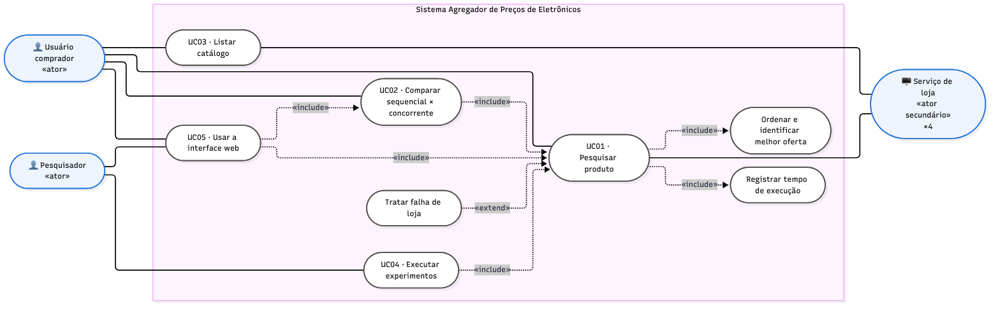
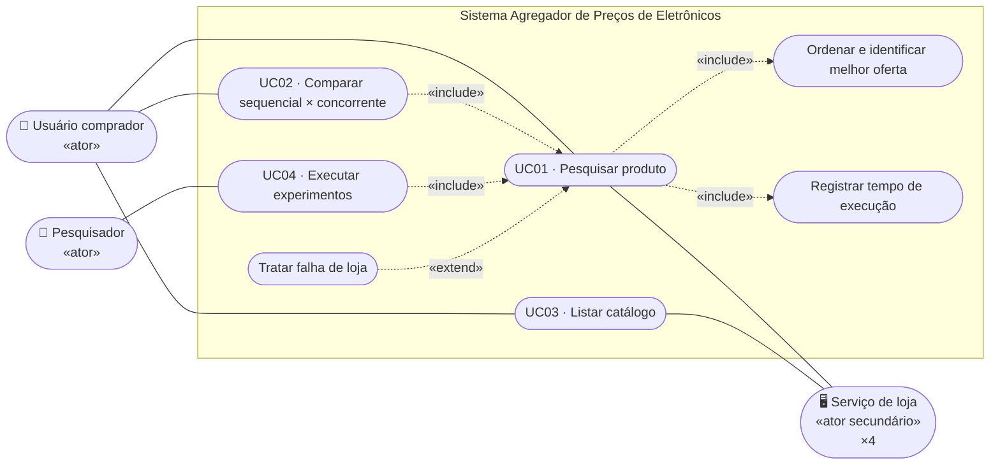
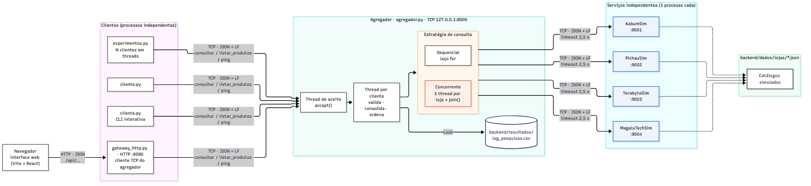
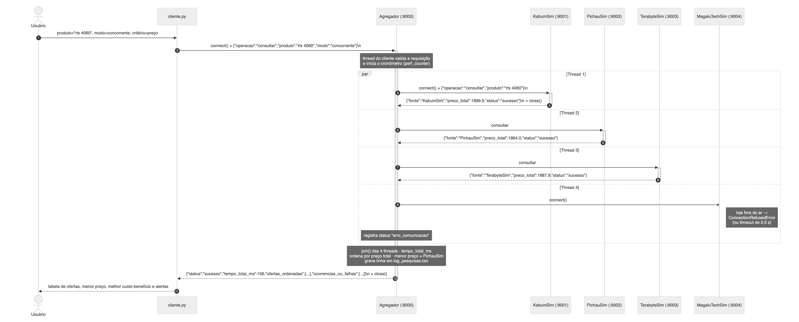
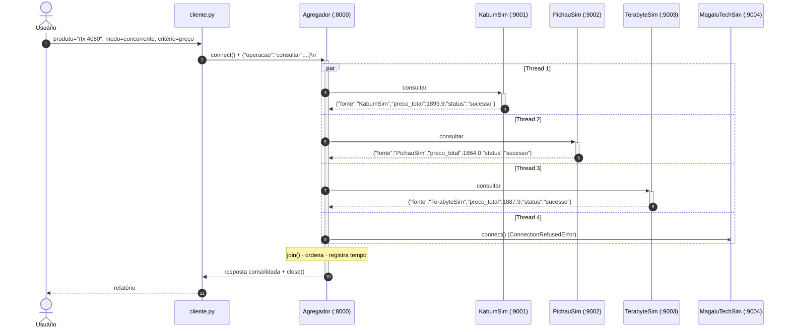

# Modelagem — Agregador de Preços de Eletrônicos

**UNIFESSPA · FACSI · Sistemas Distribuídos · Trabalho 1 — Tema 6**
Grupo VI: Youri, José Miguel, Mateus Leitão, Michelangelo e Ângelo

Os diagramas foram escritos em **Mermaid**: as fontes ficam em `diagramas/*.mmd` e o GitHub e o VS Code as renderizam. As imagens PNG em `img/` são usadas no relatório e nos slides.

---

## 1. Diagrama de casos de uso (UML)

| Caso de uso | Ator | Descrição resumida |
|---|---|---|
| UC01 · Pesquisar produto | Usuário comprador; Serviço de loja | Pesquisa um eletrônico nas 4 lojas e apresenta as ofertas consolidadas |
| UC02 · Comparar sequencial × concorrente | Usuário comprador | Executa o UC01 nos dois modos e mostra o speedup («include» UC01) |
| UC03 · Listar catálogo | Usuário comprador; Serviço de loja | Mostra os produtos disponíveis |
| UC04 · Executar experimentos | Pesquisador | Roda os 5 experimentos e gera tabelas e gráficos («include» UC01) |
| UC05 · Usar a interface web | Usuário comprador; Pesquisador | Pesquisa, compara, derruba/sobe lojas, faz teste de carga e vê os experimentos pelo navegador («include» UC01, UC02) |
| Ordenar e identificar melhor oferta | — | Incluído no UC01: ordena por preço total ou custo-benefício |
| Registrar tempo de execução | — | Incluído no UC01: grava o tempo em `log_pesquisas.csv` |
| Tratar falha de loja | — | Estende o UC01 quando uma loja está fora do ar, cai ou estoura o timeout |

Fonte Mermaid

## 2. Diagrama de arquitetura

**Componentes**

| Componente | Processo | Porta | Concorrência interna |
|---|---|---|---|
| **Cliente** (`cliente.py`) | um por usuário | efêmera | — (em `experimentos.py`, N clientes em threads) |
| **Gateway HTTP** (`gateway_http.py`) | 1 | 8080 (HTTP) | 1 thread por requisição HTTP; é um cliente TCP do agregador (no teste de carga, N clientes em threads) |
| **Interface web** (`frontend/`, Vite + React) | navegador | 5173 em desenvolvimento | — (fala só HTTP com o gateway) |
| **Agregador** (`agregador.py`) | 1 | 8000 | Thread de aceite + 1 thread por cliente; no modo concorrente, +1 thread por loja |
| **Lojas** (`loja_server.py` × 4) | 4 independentes | 9001–9004 | Thread de aceite + 1 thread por conexão |
| **Catálogos** (`backend/dados/lojas/*.json`) | — | — | Lidos uma vez quando a loja inicia |

**Módulos de apoio**

| Módulo | Função |
|---|---|
| `protocolo.py` | Envio e recebimento das mensagens, operações e códigos de status (ver `03_protocolo.md`) |
| `servidor_base.py` | Servidor TCP multithread genérico, usado pelo agregador e pelas lojas |
| `config.py` | Endereços, portas, latências e timeouts |
| `iniciar_servicos.py` | Sobe as 5 instâncias de servidor (4 lojas + agregador) como processos e espera responderem a `ping` (também usado pelo gateway) |

Todos os módulos Python ficam em `backend/`.

**Fluxo de comunicação.** O cliente abre uma conexão TCP com o agregador e envia uma requisição. A thread do cliente no agregador escolhe a estratégia:

- **sequencial**: um laço consulta loja por loja;
- **concorrente**: uma thread por loja, todas aguardadas com `join()`.

Cada consulta a uma loja é uma conexão TCP própria, com timeout de 2,5 s. As respostas são consolidadas, o tempo é registrado no CSV (com `Lock`) e o resultado volta ao cliente na mesma conexão.

**Interface web.** O navegador não abre sockets TCP, então a interface chama o gateway por HTTP/JSON (`/api/...`). O gateway valida o pedido e usa a mesma função do `cliente.py` (`requisitar_agregador`) para abrir uma conexão TCP com o agregador. Do agregador para dentro nada muda: ele não sabe se o pedido veio da CLI ou da interface. A API HTTP está no apêndice de `03_protocolo.md`.

Fonte Mermaid

Ver `diagramas/arquitetura.mmd`.

## 3. Diagrama de sequência — "Pesquisar produto" (modo concorrente, com uma loja fora do ar)

O bloco `par` mostra as quatro consultas executadas **ao mesmo tempo**, em threads diferentes. A thread 4 ilustra o tratamento de falha: a conexão com a MagaluTechSim é recusada e o agregador registra `erro_comunicacao`, sem atrasar as demais. O tempo total corresponde ao da consulta mais lenta, e não à soma.

No **modo sequencial**, o diagrama seria igual, mas sem o bloco `par`: as mensagens 3–9 aconteceriam uma após a outra, e cada consulta só começaria depois da resposta da anterior.

Fonte Mermaid

