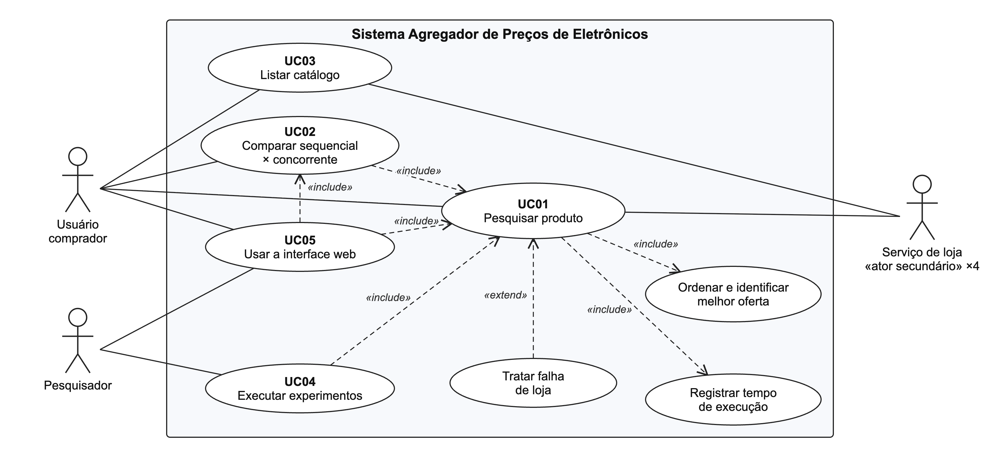
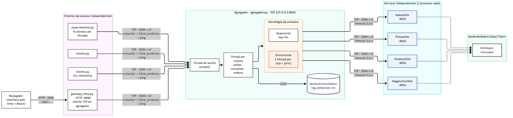
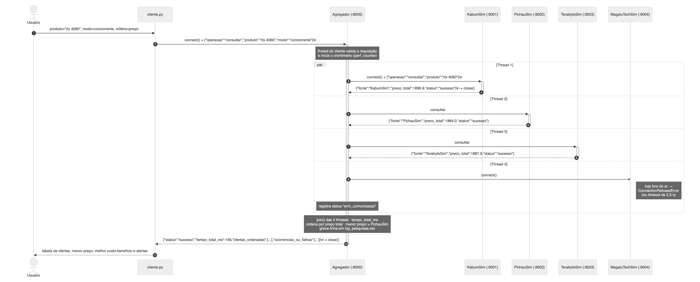
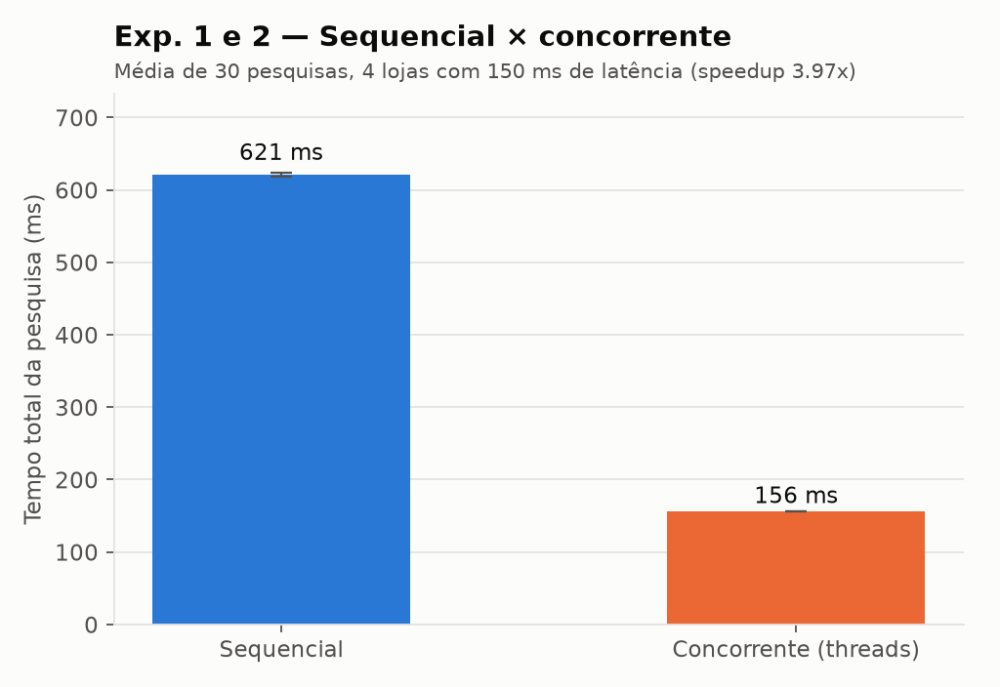
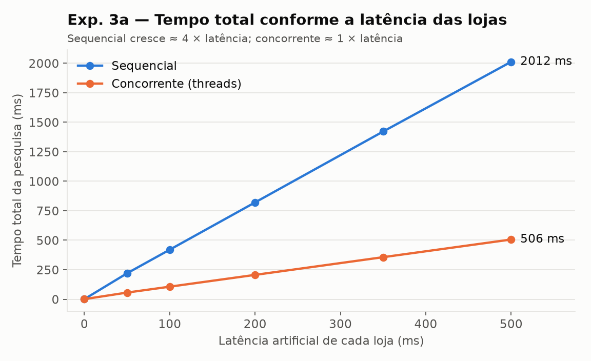
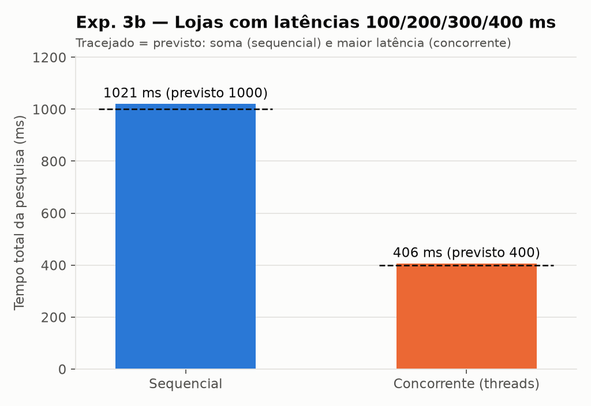
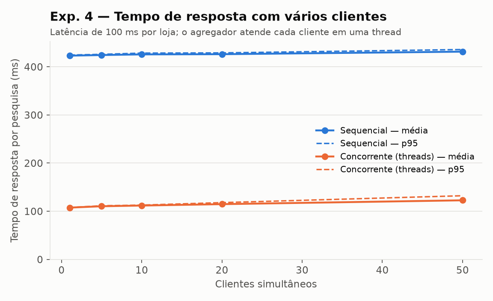
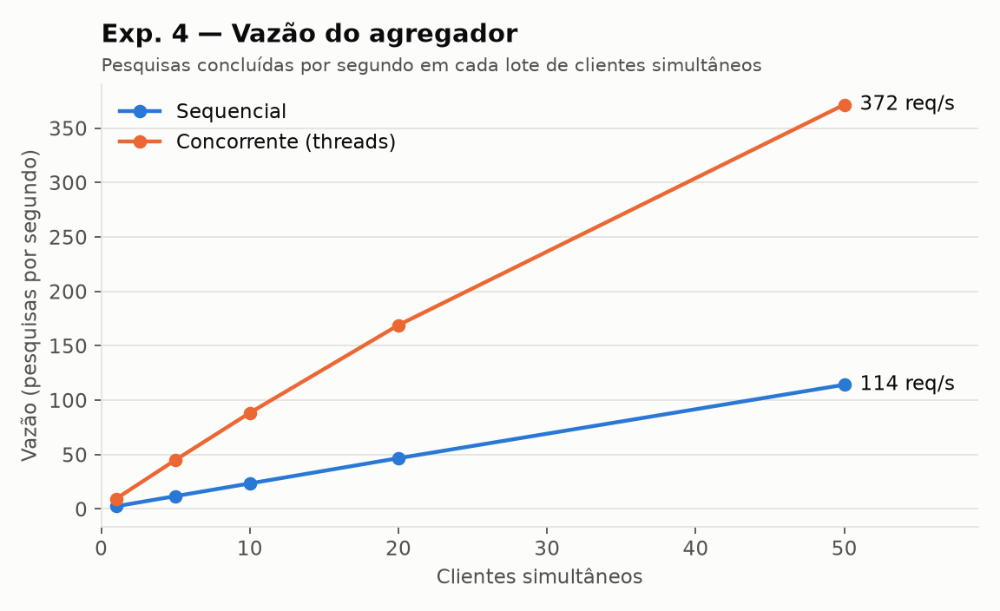
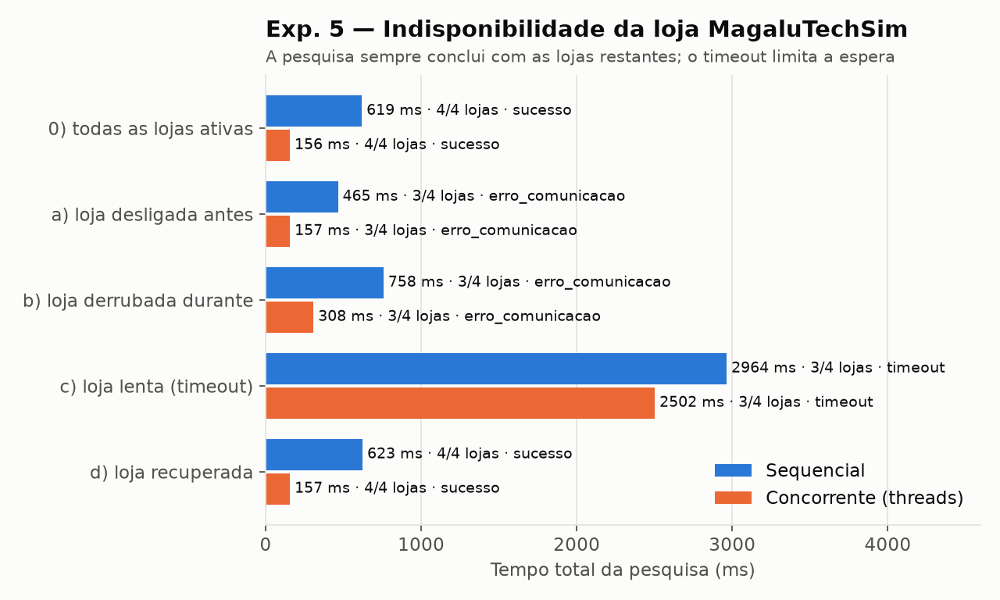

# Relatório Técnico — Agregador Concorrente de Preços de Eletrônicos

**UNIVERSIDADE FEDERAL DO SUL E SUDESTE DO PARÁ (UNIFESSPA)**
Faculdade de Sistemas de Informação (FACSI) · Sistemas Distribuídos · Prof. Gleison de Oliveira Medeiros
Trabalho 1 — Tema 6: Agregador de Preços de Eletrônicos
**Grupo VI:** Youri, José Miguel, Mateus Leitão, Michelangelo e Ângelo
Novembro de 2026

---

## 1. Introdução

Comparadores de preço, buscadores de passagens e outros agregadores consultam várias fontes independentes para responder a uma única pergunta do usuário. Cada consulta atravessa a rede e tem latência própria. Por isso, a forma de organizar essas consultas determina o tempo de resposta percebido: uma após a outra (**sequencial**) ou todas ao mesmo tempo (**concorrente**).

Este trabalho implementa um agregador de preços de eletrônicos baseado em **sockets TCP** e **multithreading** em Python. O usuário pesquisa um produto (por exemplo, "rtx 4060" ou "notebook") e o agregador consulta quatro lojas simuladas, cada uma rodando como processo servidor independente. Em seguida, ordena as ofertas pelo preço total (preço + frete) ou por um índice de custo-benefício e destaca a melhor opção. Também foram realizados os cinco experimentos exigidos pelo enunciado, que comparam as duas estratégias, avaliam o efeito da latência, a carga de vários clientes e a tolerância à indisponibilidade de uma loja.

O documento está organizado assim:
- seção 2: requisitos;
- seção 3: modelagem;
- seção 4: implementação;
- seção 5: metodologia dos experimentos;
- seção 6: resultados;
- seção 7: discussão;
- seção 8: conclusões.

## 2. Requisitos

A especificação completa está em `01_documento_requisitos.md`, organizada como pede a seção 5 do enunciado: descrição do problema, objetivo, escopo, atores, requisitos funcionais e não funcionais, restrições e critérios de aceitação. Em resumo:

- **Escopo:** cliente de linha de comando e interface web, agregador TCP, quatro lojas com catálogos simulados, consultas sequenciais e concorrentes, ordenação por preço e custo-benefício, tratamento de falhas, registro de tempos e os cinco experimentos. Ficam de fora lojas e preços reais, autenticação, pagamento, banco de dados e execução entre máquinas.
- **Atores:** Usuário comprador, Pesquisador (experimentos) e Serviço de loja (ator secundário).
- **Requisitos funcionais (RF01–RF08):** um para cada exemplo da seção 5.2 do enunciado, adaptado ao tema.
  - RF01 informar os parâmetros da pesquisa (produto, com a lista do catálogo; modo; critério);
  - RF02 consultar ≥ 4 lojas independentes, cada uma em seu processo;
  - RF03 consultas sequenciais;
  - RF04 consultas concorrentes com threads;
  - RF05 apresentar as ofertas (specs, frete, garantia, avaliação, tempo por loja) e as lojas sem o produto ou com falha;
  - RF06 ordenar por preço total ou custo-benefício;
  - RF07 identificar o menor preço e o melhor custo-benefício;
  - RF08 registrar o tempo de execução (total e por loja) e comparar os modos (speedup).
- **Requisitos não funcionais (RNF01–RNF05):** um para cada exemplo da seção 5.3.
  - RNF01 comunicação por sockets TCP, com o protocolo JSON documentado;
  - RNF02 estratégia concorrente com threads (tempo ≈ maior latência);
  - RNF03 atendimento a múltiplas conexões simultâneas (≥ 50 clientes);
  - RNF04 tratamento de falhas de comunicação sem derrubar o agregador;
  - RNF05 experimentos de desempenho (latência configurável, execução automatizada).
- **Interfaces:** o `cliente.py` e a interface web (via gateway HTTP, mais um cliente TCP do agregador) atendem os mesmos requisitos.
- **Restrições:** Python 3.10+ com biblioteca padrão e sockets TCP reais, pelo menos quatro serviços em processos e portas próprios (9001–9004, agregador em 8000), dados simulados em JSON e execução local.
- **Critérios de aceitação:** 18 critérios (CA01–CA18), cada um ligado a um teste automatizado ou a um experimento.

## 3. Modelagem

Os diagramas completos estão em `02_modelagem.md`.

**Casos de uso (UML).** UC01 Pesquisar produto, UC02 Comparar estratégias, UC03 Listar catálogo, UC04 Executar experimentos e UC05 Usar a interface web. "Ordenar e identificar melhor oferta" e "Registrar tempo de execução" são incluídos pelo UC01, e "Tratar falha de loja" o estende. UC02, UC04 e UC05 incluem o UC01; o UC05 também inclui o UC02.



**Arquitetura.** São três camadas de processos: clientes → agregador (porta 8000) → quatro lojas (portas 9001–9004). Toda a comunicação entre eles usa TCP com mensagens JSON delimitadas por quebra de linha. O navegador fala HTTP apenas com o gateway (porta 8080), que é mais um cliente TCP do agregador.



**Sequência.** O diagrama mostra a pesquisa em modo concorrente: quatro threads consultam as lojas em paralelo (bloco `par`), e a falha de uma delas é registrada sem atrasar as demais.



## 4. Implementação

### 4.1 Organização do código (`agregador_precos_eletronicos/`)

O sistema distribuído fica em `backend/` e a interface web em `frontend/` (seção 4.7). A tabela abaixo descreve `backend/`.

| Arquivo | Responsabilidade |
|---|---|
| `protocolo.py` | Framing JSON + `\n` (`enviar_json`, `receber_json`, `requisitar`, `ping`), limite de 64 KB, constantes de operações, modos, critérios e status, exceções `ConexaoEncerrada` e `MensagemInvalida`, validação de pesquisa compartilhada (`validar_pesquisa`) |
| `servidor_base.py` | `ServidorTCPMultithread`: `accept()` em laço, **uma thread por conexão**, timeout de ociosidade, respostas de erro padronizadas e proteção contra exceções no tratamento |
| `loja_server.py` | Serviço de loja: carrega `dados/lojas/<loja>.json`, simula latência (`time.sleep`) e responde `consultar`, `listar_produtos` e `ping` |
| `agregador.py` | Classe `Agregador`: valida requisições, consulta as lojas (sequencial ou concorrente), consolida, ordena, calcula o custo-benefício e registra o tempo em CSV |
| `cliente.py` | CLI interativa ou por argumentos (`--modo`, `--criterio`, `--atraso`, `--clientes`, `--listar`) com tratamento amigável de erros; `--clientes N` dispara N clientes simultâneos (Exp. 4 ao vivo) |
| `config.py` | Endereços, portas, latências e timeouts centralizados |
| `iniciar_servicos.py` | Sobe as 4 lojas e o agregador como processos e aguarda o `ping` de cada um; no terminal, aceita `derrubar <loja>`, `subir <loja>` e `status` (Exp. 5 ao vivo) |
| `experimentos.py` / `graficos.py` | Bateria dos 5 experimentos e geração dos gráficos |
| `gateway_http.py` | Ponte HTTP/JSON (porta 8080) para a interface web; é um cliente TCP do agregador (seção 4.7) |
| `tests/` | 90 testes automatizados (`unittest`): unidade, integração e sistema |

### 4.2 Estratégias de consulta

O núcleo está em `Agregador.consultar_todas`:

```python
resultados = [None] * len(self.lojas)

def tarefa(indice, loja):
    resultados[indice] = self.consultar_loja(loja, mensagem)

if modo == "sequencial":
    for i, loja in enumerate(self.lojas):
        tarefa(i, loja)                      # espera cada loja responder
else:
    threads = [threading.Thread(target=tarefa, args=(i, loja))
               for i, loja in enumerate(self.lojas)]
    for t in threads: t.start()              # dispara as 4 consultas
    for t in threads: t.join()               # aguarda todas
```

Cada thread escreve apenas na sua própria posição de uma lista pré-alocada. Por isso não é preciso lock para os resultados, e a ordem do cadastro é preservada. O tempo é medido com `time.perf_counter()` em dois níveis:
- `tempo_total_ms`, da pesquisa inteira;
- `tempo_loja_ms`, de cada loja.

### 4.3 Consolidação e critérios

- **Preço total** = preço + frete. A ordenação por preço usa esse valor.
- **Custo-benefício** (evolução do Tema 6): `score = avaliação² × (1 + 0,01 × garantia_meses) / preço_total × 1000`. A fórmula favorece produtos bem avaliados e com garantia longa, ponderados pelo preço.
- A resposta traz `menor_preco`, `melhor_custo_beneficio`, `ofertas_ordenadas`, `tempos_lojas_ms`, `lojas_sem_produto` e `ocorrencias_ou_falhas`.

### 4.4 Tratamento de erros e desconexões

| Situação | Detecção | Resultado |
|---|---|---|
| Loja fora do ar | `ConnectionRefusedError` no `connect()` | `erro_comunicacao` para a loja; a pesquisa continua |
| Loja cai durante a consulta | `recv()` retorna vazio → `ConexaoEncerrada` | `erro_comunicacao` imediato, sem esperar o timeout |
| Loja travada ou lenta | `socket.timeout` após 2,5 s | `timeout` para a loja |
| Mensagem malformada ou > 64 KB | `MensagemInvalida` | `erro_requisicao` |
| Loja responde `sucesso` com dados incompletos ou de tipo errado | `validar_resposta_loja` → `MensagemInvalida` | `erro_comunicacao` para a loja; a pesquisa continua |
| Parâmetro inválido | validação no agregador | `erro_requisicao` com o motivo |
| Cliente conecta e não envia nada | timeout de ociosidade (5 s) | `erro_requisicao`; a thread é liberada |
| Exceção inesperada no servidor | `try/except` em `servidor_base` | `erro_interno`; o servidor continua no ar |
| Agregador fora do ar (no cliente) | `ConnectionRefusedError` | mensagem amigável, código de saída 1 |
| Portas já ocupadas ao subir o ambiente | `iniciar_servicos.porta_em_uso` | `iniciar_servicos.py` encerra com código 1 e não deixa processos órfãos |
| `iniciar_servicos.py` recebe Ctrl+C, SIGTERM ou SIGHUP | tratamento de sinais | todas as lojas e o agregador são encerrados |

### 4.5 Protocolo

O protocolo usa JSON UTF-8 terminado por `\n`, com uma requisição e uma resposta por conexão, que é fechada pelo servidor. Há três operações (`consultar`, `listar_produtos`, `ping`) e seis códigos de status. Ver `03_protocolo.md`.

### 4.6 Testes

Os 90 testes automatizados (`cd backend && python -m unittest discover -s tests`) se dividem em três níveis. Os testes de unidade e integração sobem lojas e agregador em threads, em portas efêmeras. Os testes de sistema (`tests/test_sistema.py`) sobem os processos reais nas portas 8000 e 9001–9004 e usam o `cliente.py` como na apresentação. Eles cobrem:
- framing (fragmentação, JSON inválido, limite de tamanho, conexão encerrada, timeout);
- ordenação e menor preço;
- equivalência entre os modos sequencial e concorrente;
- desempenho (concorrente < sequencial; latências heterogêneas);
- loja desligada, queda durante a consulta, timeout e todas as lojas fora;
- validação de requisições;
- registro em CSV;
- 20 clientes simultâneos;
- agregador fora do ar no cliente;
- respostas inválidas de loja (campos ausentes ou de tipo errado);
- serviço de loja isolado (busca, item mais barato, validação);
- gerenciamento de processos (porta ocupada, limpeza, SIGTERM);
- roteiro completo da demonstração com processos reais, um passo por experimento (inclusive N clientes pela CLI e uma loja derrubada pelo console durante a pesquisa);
- gateway HTTP da interface web (pesquisa, comparação, validação, falhas, carga, derrubar/subir loja, arquivos servidos).

Todos passam. O plano de verificação e testes completo, com a matriz de atendimento ao enunciado, está em `05_plano_verificacao_testes.md`.

### 4.7 Interface web

Para a demonstração, há também uma interface web (`frontend/`, Vite + React + TypeScript) com quatro telas: pesquisa e comparação dos modos, lojas e falhas (derrubar e subir cada loja), teste de carga com até 50 clientes simultâneos e resultados dos experimentos com o registro de pesquisas. O visual foi desenhado no Claude Design, com a mesma paleta dos slides.

Como o navegador não abre sockets TCP, a interface chama o **gateway HTTP** (`backend/gateway_http.py`, só biblioteca padrão: `http.server.ThreadingHTTPServer`). O gateway não substitui nada do sistema: ele é mais um cliente TCP do agregador e usa a mesma função do `cliente.py`. O HTTP existe apenas entre o navegador e o gateway, e a comunicação agregador ↔ lojas continua igual. Por padrão, o gateway sobe as lojas e o agregador com `iniciar_servicos.Ambiente`, o que permite derrubar e subir uma loja pela interface; com `--externo`, ele só se conecta a serviços já em execução. A API está no Apêndice A de `03_protocolo.md`.

## 5. Metodologia dos experimentos

- **Ambiente:** macOS (Darwin arm64), 10 CPUs, Python 3.15.0, tudo em `127.0.0.1`.
- **Execução de referência:** bateria completa de 14/11/2026 (14h03), com a versão final do código, depois das correções registradas em `05_plano_verificacao_testes.md`. A saída completa está em `backend/resultados/saida_experimentos.txt`.
- **Processos:** 4 lojas e o agregador como processos independentes (`iniciar_servicos.Ambiente`). As medições passam pelo cliente TCP real.
- **Latência simulada:** `time.sleep` na loja antes de responder, representando o tempo de rede e de processamento de um serviço remoto. A latência vem do campo `atraso_ms` da requisição ou da configuração de cada loja.
- **Métrica principal:** `tempo_total_ms` medido no agregador. No Exp. 4 também foi medido o tempo de resposta no cliente.
- **Repetições:** 30 por modo (Exp. 1 e 2); 10 por ponto (Exp. 3); 3 rodadas por ponto (Exp. 4). As tabelas mostram média, desvio-padrão, mínimo e máximo.
- **Produto pesquisado:** "notebook" (as 4 lojas o possuem).
- **Reprodução:** em `backend/`, `python experimentos.py && python graficos.py`. Os dados brutos ficam em `backend/resultados/*.csv` e as tabelas em `backend/resultados/tabelas.md`.

| Exp. | Configuração |
|---|---|
| 1 — Sequencial | 4 lojas × 150 ms, modo sequencial, 30 repetições |
| 2 — Concorrente | 4 lojas × 150 ms, modo concorrente, 30 repetições |
| 3a — Latência uniforme | 0, 50, 100, 200, 350 e 500 ms em todas as lojas |
| 3b — Latência heterogênea | lojas com 100, 200, 300 e 400 ms |
| 4 — Múltiplos clientes | 1, 5, 10, 20 e 50 clientes disparados juntos (barreira), lojas com 100 ms |
| 5 — Indisponibilidade | MagaluTechSim: (a) desligada antes; (b) derrubada durante a consulta; (c) lenta além do timeout; (d) recuperada |

## 6. Resultados

### 6.1 Experimentos 1 e 2 — sequencial × concorrente

| Modo | n | Média (ms) | Desvio (ms) | Mín. (ms) | Máx. (ms) | Speedup |
|---|---|---|---|---|---|---|
| Sequencial | 30 | 621,11 | 2,52 | 612,83 | 623,64 | 1,00 |
| Concorrente | 30 | 156,50 | 0,24 | 156,01 | 156,89 | **3,97** |



### 6.2 Experimento 3 — simulação de latência

**3a — Latência igual em todas as lojas**

| Latência/loja (ms) | Sequencial (ms) | Concorrente (ms) | Speedup |
|---|---|---|---|
| 0 | 0,87 | 0,72 | 1,21 |
| 50 | 219,69 | 56,35 | 3,90 |
| 100 | 419,89 | 106,35 | 3,95 |
| 200 | 820,59 | 206,34 | 3,98 |
| 350 | 1.421,23 | 356,36 | 3,99 |
| 500 | 2.012,21 | 506,13 | 3,98 |



**3b — Latências diferentes (100/200/300/400 ms)**

| Modo | Média (ms) | Desvio (ms) | Previsto (ms) | Regra |
|---|---|---|---|---|
| Sequencial | 1.020,55 | 3,77 | 1.000 | soma das latências |
| Concorrente | 405,93 | 1,36 | 400 | maior latência |



### 6.3 Experimento 4 — múltiplos clientes

| Clientes | Modo | Resposta média (ms) | p95 (ms) | Lote (ms) | Vazão (req/s) | Falhas |
|---|---|---|---|---|---|---|
| 1 | sequencial | 423,07 | 424,33 | 423,27 | 2,36 | 0 |
| 1 | concorrente | 107,39 | 107,59 | 107,55 | 9,30 | 0 |
| 5 | sequencial | 424,31 | 425,80 | 426,07 | 11,74 | 0 |
| 5 | concorrente | 110,23 | 111,25 | 111,11 | 45,00 | 0 |
| 10 | sequencial | 425,69 | 428,36 | 427,70 | 23,38 | 0 |
| 10 | concorrente | 111,70 | 112,63 | 113,28 | 88,28 | 0 |
| 20 | sequencial | 426,08 | 428,80 | 429,27 | 46,59 | 0 |
| 20 | concorrente | 114,59 | 117,77 | 118,39 | 168,93 | 0 |
| 50 | sequencial | 431,34 | 435,76 | 438,25 | 114,09 | 0 |
| 50 | concorrente | 122,57 | 132,09 | 134,57 | 371,56 | 0 |





### 6.4 Experimento 5 — indisponibilidade de serviço

| Cenário | Modo | Tempo (ms) | Lojas OK | Status da loja afetada | Causa |
|---|---|---|---|---|---|
| 0) todas ativas | sequencial | 618,95 | 4/4 | sucesso | — |
| 0) todas ativas | concorrente | 156,23 | 4/4 | sucesso | — |
| a) desligada antes | sequencial | 465,06 | 3/4 | erro_comunicacao | ConnectionRefusedError |
| a) desligada antes | concorrente | 156,59 | 3/4 | erro_comunicacao | ConnectionRefusedError |
| b) derrubada durante | concorrente | 307,69 | 3/4 | erro_comunicacao | ConexaoEncerrada |
| b) derrubada durante | sequencial | 757,82 | 3/4 | erro_comunicacao | ConexaoEncerrada |
| c) lenta (timeout) | sequencial | 2.964,30 | 3/4 | timeout | TimeoutError |
| c) lenta (timeout) | concorrente | 2.502,33 | 3/4 | timeout | TimeoutError |
| d) recuperada | sequencial | 623,37 | 4/4 | sucesso | — |
| d) recuperada | concorrente | 156,74 | 4/4 | sucesso | — |

Em todos os cenários a pesquisa foi concluída e o menor preço (PichauSim) foi identificado corretamente.



## 7. Discussão

**Ganho da concorrência (Exp. 1–3).**
- No modo sequencial, o tempo total segue a soma das latências: 4 × 150 ms = 600 ms previstos contra 621 ms medidos.
- No modo concorrente, segue a maior latência: 150 ms previstos contra 156,5 ms medidos.
- O speedup observado (3,97×) fica praticamente no teórico, igual ao número de lojas (4×).
- O experimento 3b confirma a regra com latências diferentes: o sequencial levou 1.021 ms (soma = 1.000) e o concorrente 406 ms (máximo = 400). O modo concorrente fica limitado pela **loja mais lenta**, não pelo número de lojas.

**Por que threads funcionam aqui, mesmo com o GIL.** O trabalho do agregador é quase todo **espera de E/S**: `connect`, `recv` e a latência das lojas. Durante chamadas bloqueantes de socket e `sleep`, o interpretador Python libera o GIL, então as quatro esperas se sobrepõem de verdade. Em uma carga limitada por CPU (por exemplo, cálculos pesados no agregador), o GIL serializaria as threads e o ganho praticamente desapareceria. Nesse caso seriam necessários processos (`multiprocessing`).

**Sobrecarga.** Há um custo fixo por consulta: criar o socket, fazer o *handshake* TCP, serializar o JSON e, no modo concorrente, criar a thread.
- Com latência zero (Exp. 3a), as duas estratégias levam menos de 1 ms e o speedup cai para 1,21×. Quando não há espera, quase não há o que sobrepor.
- À medida que a latência cresce, a sobrecarga fixa (cerca de 6 ms por pesquisa no modo concorrente e de 5 ms por loja no sequencial) se dilui e o speedup tende a 4 (3,90× a 50 ms; 3,98× a 500 ms).
- Concorrência compensa quando a espera domina o processamento.

**Múltiplos clientes (Exp. 4).**
- O agregador cria uma thread por cliente, e por isso clientes simultâneos não esperam uns pelos outros.
- Mesmo no modo sequencial, o tempo de resposta mudou pouco de 1 para 50 clientes (423 → 431 ms), porque cada cliente tem a sua própria thread.
- No modo concorrente, com 50 clientes, o agregador manteve ~200 conexões simultâneas com as lojas. O tempo médio subiu só de 107 para 123 ms (p95 = 132 ms) e não houve falhas.
- A vazão cresceu quase linearmente: de 9,3 para 372 req/s no modo concorrente, e de 2,4 para 114 req/s no sequencial.
- O pequeno aumento de latência com mais clientes vem da criação de muitas threads e da disputa pelo GIL nos trechos de CPU (parse de JSON, ordenação).
- O modelo de "uma thread por conexão" escalaria mal para milhares de clientes (memória por thread, troca de contexto). Nesse caso, um *pool* de threads (`ThreadPoolExecutor`) ou E/S assíncrona (`asyncio`) seria mais adequado.

**Tolerância a falhas (Exp. 5).**
- **(a) Loja desligada:** a recusa de conexão é detectada em ~1 ms. No modo sequencial a pesquisa até ficou mais rápida (465 ms), porque havia uma loja a menos para esperar.
- **(b) Queda durante a consulta:** o agregador percebeu o fechamento da conexão no momento da queda (308 ms no concorrente, 758 ms no sequencial), sem esperar o timeout.
- **(c) Loja travada:** é o pior caso, e o **timeout** é essencial. No modo concorrente a espera ficou limitada a ~2,5 s. No sequencial, o timeout soma-se às outras latências (2.964 ms). Sem timeout, a pesquisa ficaria bloqueada indefinidamente.
- **(d) Recuperação:** como cada pesquisa abre conexões novas (protocolo sem estado), a loja recuperada voltou a ser consultada automaticamente, sem reiniciar o agregador.
- Em todos os casos o resultado parcial (3/4) foi entregue, e a falha foi identificada por loja e por causa.

**Limitações.**
- A latência é simulada com `sleep` em localhost; uma rede real teria variação (jitter) e perdas.
- Os catálogos são pequenos e estáticos.
- O agregador não usa cache, nem reenvia consultas que falharam, nem replica as lojas. Esses são caminhos naturais para o projeto final da disciplina.

## 8. Conclusões

O sistema cumpre os requisitos do enunciado:
- comunicação real por **sockets TCP** entre cliente, agregador e **quatro lojas independentes** (processos separados);
- consultas **sequenciais e concorrentes** (threads);
- atendimento a **múltiplos clientes**;
- **protocolo JSON documentado**;
- **tratamento de erros e desconexões**;
- **registro do tempo** de cada pesquisa;
- consolidação com identificação do menor preço e do melhor custo-benefício.

Sobre multithreading, os experimentos mostram que:

1. Para consultas independentes e limitadas por E/S, threads reduzem o tempo de resposta da **soma** para o **máximo** das latências. Com 4 lojas, o ganho medido foi de 3,97×, praticamente o teórico (4×).
2. O ganho depende de a espera dominar o processamento: com latência nula, o speedup é desprezível.
3. Uma thread por cliente permite atender dezenas de usuários simultâneos com aumento pequeno no tempo de resposta e vazão crescendo quase linearmente.
4. Concorrência também melhora a robustez: uma loja lenta ou fora do ar não atrasa as consultas às demais. Combinada com timeouts, garante um limite superior para o tempo da pesquisa.

## Referências

- TANENBAUM, Andrew S.; VAN STEEN, Maarten. *Distributed Systems: Principles and Paradigms*. 2. ed. Prentice Hall, 2007.
- SOMMERVILLE, Ian. *Software Engineering*. 10. ed. Pearson, 2015.
- PYTHON SOFTWARE FOUNDATION. *socket — Low-level networking interface*. Disponível em: https://docs.python.org/3/library/socket.html.
- PYTHON SOFTWARE FOUNDATION. *threading — Thread-based parallelism*. Disponível em: https://docs.python.org/3/library/threading.html.
